

  <a href="https://mrccorps.is-a.dev">
    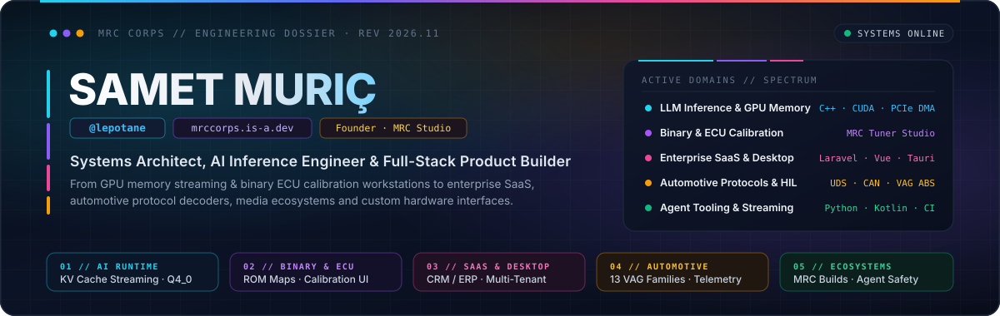
  </a>

 

  
  
  
  
  

 

  <picture>
    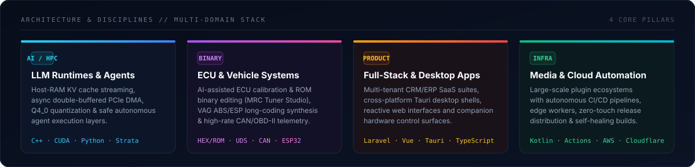
  </picture>

 

  <picture>
    
  </picture>

## Flagship Engineering & Systems

<!-- PROJECTS:START -->
<table>
  <tr>
    <td width="50%" align="center">
      <a href="https://mrc-tuner-studio.github.io/">
        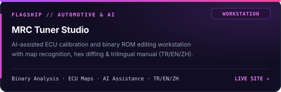
      </a>
    </td>
    <td width="50%" align="center">
      <a href="https://github.com/simplexai-labs/PolyStrata/pull/180">
        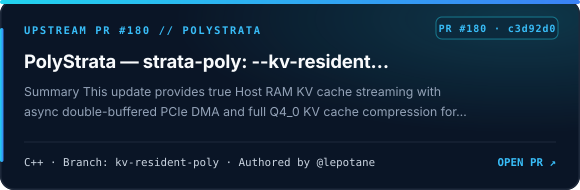
      </a>
    </td>
  </tr>
  <tr>
    <td width="50%" align="center">
      <a href="https://github.com/lepotane/mrc-crm-erp-saas-system">
        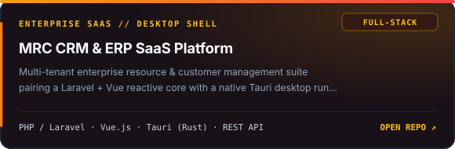
      </a>
    </td>
    <td width="50%" align="center">
      <a href="https://github.com/lepotane/VAG-ABS-Coding-Calculator">
        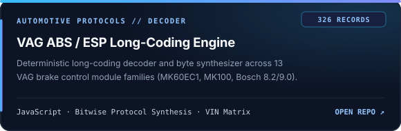
      </a>
    </td>
  </tr>
  <tr>
    <td width="50%" align="center">
      <a href="https://github.com/lepotane/MRC-builds">
        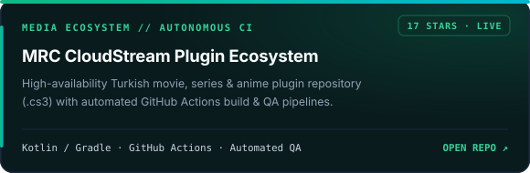
      </a>
    </td>
    <td width="50%" align="center">
      <a href="https://lepotane.github.io/mrc-site/">
        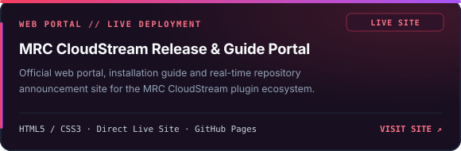
      </a>
    </td>
  </tr>
  <tr>
    <td width="50%" align="center">
      <a href="https://github.com/lepotane/T-CAN485-CANLogger">
        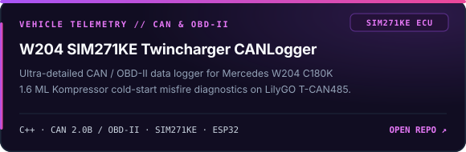
      </a>
    </td>
    <td width="50%" align="center">
      <a href="https://github.com/lepotane/gemini-bypass-permission">
        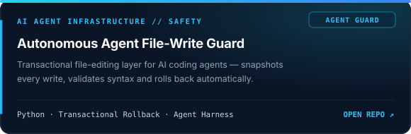
      </a>
    </td>
  </tr>
  <tr>
    <td width="50%" align="center">
      <a href="https://github.com/lepotane/VIctory-leonida">
        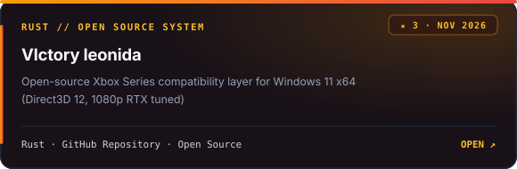
      </a>
    </td>
    <td width="50%"></td>
  </tr>
</table>
<!-- PROJECTS:END -->

 

  <picture>
    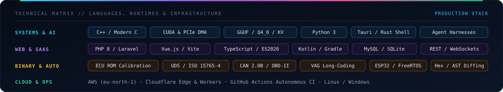
  </picture>

 

  <picture>
    
  </picture>
   
  <b>SAMET MURIÇ</b> &nbsp;·&nbsp; <a href="https://mrccorps.is-a.dev">mrccorps.is-a.dev</a> &nbsp;·&nbsp; <a href="https://lepotane.github.io/mrc-site/">MRC CloudStream Site</a> &nbsp;·&nbsp; <a href="https://github.com/mrc-tuner-studio">MRC Tuner Studio</a> &nbsp;·&nbsp; <a href="mailto:smtmrc@gmail.com">smtmrc@gmail.com</a>

